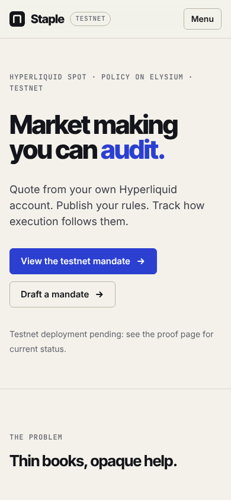
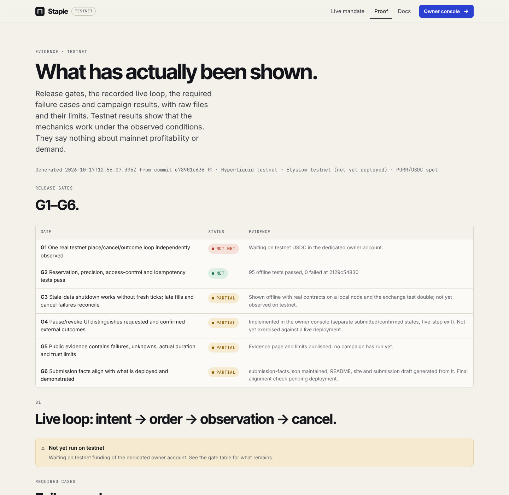

# Staple

**Market making you can audit.** Quote from your own Hyperliquid account. Publish your rules. Track how
execution follows them.

Staple lets a token team provide two-sided liquidity on a HyperCore spot book under a public, versioned policy
on Elysium. The contract computes every order as a public intent and reserves worst-case exposure first. An
open-source keeper executes the intents through a trade-only agent the owner approves. An independent watcher
reconciles every exchange order and fill against the intents. A public page shows the terms, execution,
inventory, fees, discrepancies and shutdowns.

> **Status: testnet prototype.** The contracts, keeper, watcher, sampler and web app are built and pass 96 offline
> tests. The contracts are deployed on Elysium testnet and mandate 1 is published as a draft; the hosted watcher
> sends on-chain heartbeats for it. The live trading loop (G1) and the campaign are waiting on HyperCore testnet
> funds for the owner account. The current gate status is
> on [`/proof`](https://theweirddee.github.io/staple/#/proof) and in [`submission-facts.json`](submission-facts.json).
> No real funds, no customers, no partners.


| Mobile | Evidence page |
| --- | --- |
|  |  |

## How it works

1. **Policy (Elysium).** The owner publishes a mandate: market, spread, levels, sizes, inventory bounds, loss
   trigger, volatility and staleness limits, expiry and fees. Edits are new public versions. Risk-increasing edits
   wait 60 s, and a version switches only after every old order is confirmed terminal.
2. **Intent (Elysium).** Each signed observation of the external book and the owner's balances goes through a
   bounded tick. The tick checks freshness, deviation from the mark, reconciliation, volatility, loss, fees and
   watcher health, then computes a skewed ladder. It reserves exposure for every potentially executable order and
   emits `PlaceIntent`/`CancelIntent` with a reason code.
3. **Order (HyperCore).** The keeper places post-only orders with client ids derived from the intent. It
   resolves unknown outcomes by status query after an exchange-enforced expiry, and reports acks, fills
   (exactly once) and confirmed cancels back on-chain.
4. **Reconciliation (independent).** The watcher, a separate implementation with separate keys, matches all
   exchange activity on the account to intents, reports mismatches (which stops new exposure), checks in on-chain
   (quoting fails closed without it) and runs the timer that enforces staleness and expiry without new ticks.

## Trust boundary

The contract constrains the intents it produces. The keeper's agent key can still trade outside them. The watcher
detects that afterwards and cannot undo trades. Pausing on Elysium does not revoke the agent; only the owner can,
on Hyperliquid. Observations and outcomes are signed by the reporter, which authenticates the sender, not the
data. The loss trigger stops quoting and requests cancellation. It is not a cap. Details:
[`docs/architecture.md`](docs/architecture.md).

## Repository

| Path | Contents |
| --- | --- |
| `contracts/` | Solidity (Foundry): `MandateRegistry`, `StapleDesk`, linked libraries `QuoteEngine`, `DeskOrders`, `DeskAccounting`, test fee token |
| `reference/` | Independent TypeScript quote engine, policy validation, frozen vectors, generated ABIs |
| `keeper/` | Keeper (TypeScript): HyperCore signing, execution, recovery, ops CLI, campaign controller |
| `watcher/` | Independent watcher (Python) |
| `sampler/` | Independent public-book sampler and metric computation (Python) |
| `web/` | Static web app: landing, public mandate, owner console, proof, docs |
| `deploy/` | Supervised service runner and data publisher |
| `runs/` | Market metadata, deployment record, offline results, case map, campaign results |
| `docs/` | Units, architecture, runbook, metrics, dependencies, checklist, token plan, submission, demo |

## Install and test

```bash
pnpm install                                    # Node 22, pnpm 10
pip install -r python-requirements.lock
npm i -g @foundry-rs/forge@1.7.1 @foundry-rs/anvil@1.7.1   # or foundryup

pnpm test:offline                              # every offline suite → runs/offline-tests.json
# or individually:
(cd contracts && forge test)                    # 49: lifecycle, reservations, signatures, shutdowns, vectors, fuzz
pnpm --filter @staple/reference test            # 15: frozen vectors, precision, skew, reservations, policy
pnpm --filter @staple/keeper test               # 20: local node + exchange test double; SDK signing vectors
(cd watcher && python -m pytest)                # 7
(cd sampler && python -m pytest)                # 4
pnpm dev                                      # http://localhost:5173/staple/
```

The offline tests need no keys, network or funds. Integration failure cases use a clearly labelled exchange
**test double** (`keeper/test/fake-exchange.ts`); they are not evidence of exchange integration.

## Testnet deployment and operations

See [`docs/runbook.md`](docs/runbook.md) for keys, deployment, hosted services (GitHub Actions), health
checks, the emergency shutdown order, key rotation and restart behaviour. The campaign method and frozen metrics
are in [`docs/metrics.md`](docs/metrics.md). Verified network facts are in
[`docs/dependencies.md`](docs/dependencies.md).

```bash
cd keeper
npx tsx src/ops.ts deploy && npx tsx src/ops.ts create-mandate 96
npx tsx src/ops.ts approve-agent keeper && npx tsx src/ops.ts activate
```

## Status

**Working (offline-tested):** quote engine with frozen cross-implementation vectors; worst-case reservations;
EIP-712 signed observations and outcomes with replay and domain protection; exactly-once fills; timer-driven
stale and expiry shutdowns; volatility, loss, fee, watcher and reconciliation halts; versioned policies with
notice; five-step exit; keeper recovery; watcher reconciliation; HyperCore signing matching the official SDK.

**On testnet:** contracts deployed on Elysium testnet (`runs/deployment-testnet.json`); mandate 1 created as a draft
with a fee deposit; keeper, watcher and sampler hosted on GitHub Actions, with watcher heartbeats on-chain; the
public mandate page reads the live deployment. On a separate test mandate, the Elysium-side safety paths were run
on testnet: activation fails closed until the watcher checks in, a keeper outage is halted by the watcher's poke
with no new tick, a watcher outage halts quoting, and pause is immediate (`runs/elysium-cases/`). No exchange order
was involved, because the account is unfunded.

**In development:** G1 live loop, campaign, demo footage. All are blocked on HyperCore testnet USDC for the owner
account (see the runbook).

**Before launch:** independent security review; KMS-backed keys; separated monitoring infrastructure; design-partner
pilot with explicit capital limits; Elysium native HyperCore integration once available and tested.

Pricing and the provisional token plan: [`docs/token-plan.md`](docs/token-plan.md). Requirement coverage:
[`docs/requirements-checklist.md`](docs/requirements-checklist.md).

## License

MIT

## Windows development

From PowerShell at the repository root, run `pnpm install`, then `npm run dev`.
The root dev command starts the web workspace. Use `pnpm build` to typecheck all
TypeScript packages and build the web app. Install Python dependencies in a local
virtual environment (`python -m venv .venv` followed by
`.\.venv\Scripts\python.exe -m pip install -r python-requirements.lock`).
Set `$env:STAPLE_PYTHON = "$PWD/.venv/Scripts/python.exe"` before `pnpm test:offline`.
Foundry's `forge` and `anvil` must be on PATH (WSL is an alternative for the full suite).
On Windows, install native binaries with
`npm install --prefix .tools --ignore-scripts @foundry-rs/forge-win32-amd64@1.7.1 @foundry-rs/anvil-win32-amd64@1.7.1`.
The offline runner and browser flow discover these project-local binaries automatically.
The offline runner fails if a suite cannot start, exits unsuccessfully, or reports no tests.
Browser checks use `pnpm --filter @staple/web exec playwright install chromium`, then
`pnpm e2e`; optionally set `STAPLE_CHROMIUM_PATH` to an installed browser.

Run `pnpm check:readiness` for network and deployment prerequisites. Supply public
`STAPLE_DEPLOYER_ADDRESS`, `STAPLE_OPERATOR_ADDRESS`, `STAPLE_WATCHER_ADDRESS`, and
`STAPLE_OWNER_ADDRESS` to check balances. This does not create keys or send transactions.
See [the remaining release work](docs/release-work.md) for external dependencies.
